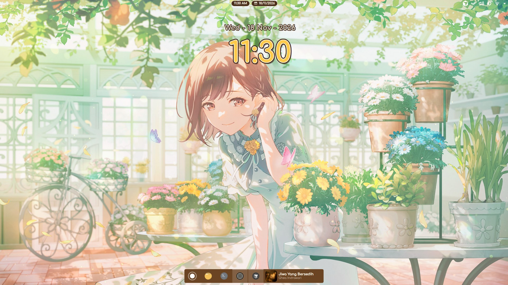

# Dotfiles

Personal configs. Clone what you need; nothing here expects a full-machine install.

## Layout

```
.
├── cozy-ena/              # Plasma rice (Bazzite)
├── .oh-my-posh-themes/    # PowerShell prompt
├── .oh-my-zsh-themes/     # Zsh prompt
├── images/                # Screenshots for the READMEs
└── proxmox-temp-gui/      # Optional Proxmox UI tweak notes
```

## Cozy Ena (Plasma)

Brown panels, clear top bar, gold Comfortaa clock, media dock with album art. Wallpaper is Project SEKAI card art — not shipped in this repo.



```bash
./cozy-ena/apply.sh
```

Full notes: [`cozy-ena/README.md`](cozy-ena/README.md).

## Oh My Posh — `zash.minimal`

File: `.oh-my-posh-themes/zash.minimal.omp.json`

Segments: user (`#E36464`), path (`#56B6C2`), git (`#D4AAFC` / `#DDB15F`), status (`#DCB977`).


## Oh My Zsh — `istaqom`

File: `.oh-my-zsh-themes/istaqom.zsh-theme`

User/host, cwd, git branch + short status, simple arrow prompt.


## License

[MIT](LICENSE)
