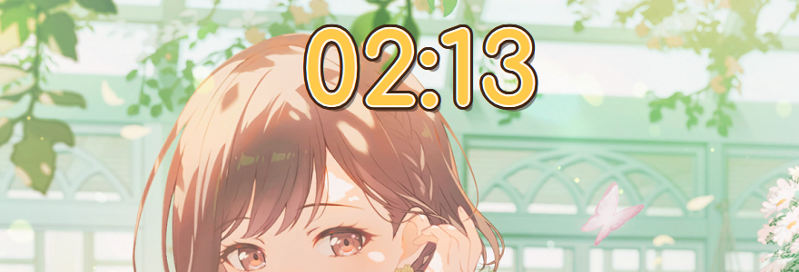

# Cozy Ena (Plasma rice)

Clear top panel (wallpaper through) + opaque brown dock/popups + Vapor apps + Tela-circle-dark + Usagi cursor + Comfortaa + floating gold clock (cream date).

## Screenshots


| Crop | Preview |
|------|---------|
| Clock |  |
| Top panel |  |
| Dock |  |
| Login user |  |

## Wallpaper (not bundled)

Art is SEGA / Colorful Palette — **not redistributed here**. Find the trained card art yourself (in-game, official channels, etc.):

| | |
|--|--|
| **Card** | *An Overwhelming Welcome!* (熱烈歓迎にたじたじ！) — also *Taken Aback By A Passionate Warm Welcome!* |
| **Character** | Shinonome Ena — 4★ permanent, 25-ji, Nightcord de., Happy |
| **Event / gacha** | *Tying Tomorrow's Ribbon* (あしたのリボンを結ぶとき) · Friendly Fuzzy Daisy Gacha |
| **Costume** | unlocks *Petit joie* (+ matching accessory) |
| **Then** | System Settings → Wallpaper / Lock screen → pick your file |

`apply-splash.sh` looks under `~/Pictures/Wallpapers/` for a local copy if you already saved one.

Optional login crop (Plasma Login Manager, needs sudo once): see notes in older `themes/cozy-ena/apply-login-wallpaper.sh` if present on this machine.

## One-shot apply

```bash
./cozy-ena/apply.sh
```

Backs up `kdeglobals` / `plasmarc` / appletsrc first → `cozy-ena/backups/`.

## What it installs

| Piece | Destination |
|-------|-------------|
| Plasma style `CozyEna` | `~/.local/share/plasma/desktoptheme/CozyEna` |
| Big clock + panel clock + media dock plasmoids | `~/.local/share/plasma/plasmoids/org.cozyena.*` |
| Splash screen `Cozy Ena` (`apply-splash.sh` copies your wallpaper in locally) | `~/.local/share/plasma/look-and-feel/org.cozyena.desktop` |
| Lock screen QML (date above clock, octagon avatar) | `~/.local/share/plasma/shells/.../lockscreen/` |
| Comfortaa | `~/.local/share/fonts/Comfortaa` |
| Usagi cursors | `~/.local/share/icons/Usagi` |
| Gold Dolphin icon | override inside Tela-circle-dark |

## Prerequisites (not bundled)

- **Tela circle icons** (`Tela-circle-dark`)
- **Vapor** color scheme (Bazzite usually has it)
- Wallpaper: *An Overwhelming Welcome!* Ena card art (see above) — obtain yourself

## Tray notes

- Discord / Cursor tray use **embedded pixmaps** → theme cannot restyle. Keep them **visible** in tray (dock still shows Tela app icons).
- Bitwarden double icon = SNI + XEmbed. Script sets `ELECTRON_OZONE_PLATFORM_HINT=wayland`; **restart Bitwarden** once.
- Volume slider uses gold Selection highlight for contrast on brown panel.
- Dock media (`org.cozyena.mediadock`): cream ♪ note when idle; expands to art + title only while playing.

## Partial scripts

```bash
./scripts/apply-fonts.sh
./scripts/apply-icons.sh
./scripts/apply-plasma-theme.sh
./scripts/apply-panels.sh
./scripts/apply-mediadock.sh
./scripts/apply-splash.sh
./scripts/apply-lockscreen.sh
./scripts/apply-notify.sh
./scripts/apply-bitwarden-tray.sh
```

## Safe plasmashell restart

```bash
systemctl --user restart plasma-plasmashell.service
```

Do **not** use bare `plasmashell --replace` (can leave panels dead).
