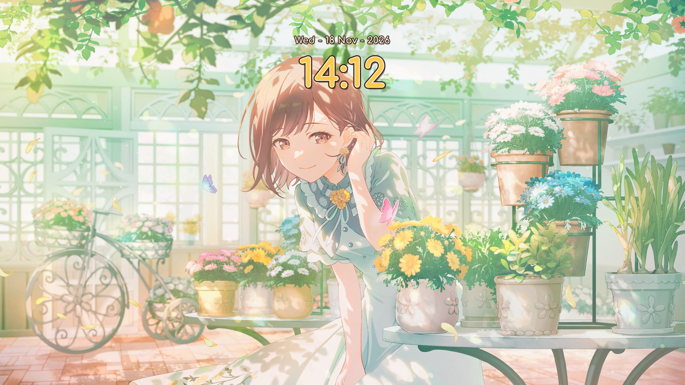
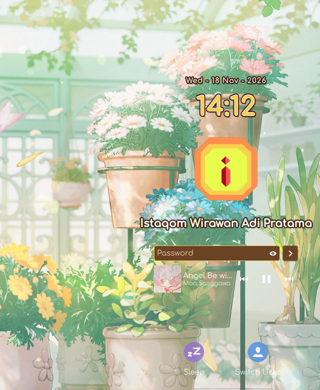

# Cozy Ena

Plasma rice for Bazzite: clear top panel, opaque brown dock/popups, Vapor colors, Tela-circle-dark, Usagi cursor, Comfortaa, floating gold clock + cream date, media dock.

## Look





| | |
|--|--|
| Clock |  |
| Dock + media |  |
| Login card |  |

## Wallpaper (not in repo)

SEGA / Colorful Palette art — get it yourself (in-game or official channels). Do not commit the PNG here.

| | |
|--|--|
| Card | *An Overwhelming Welcome!* (熱烈歓迎にたじたじ！) |
| Also called | *Taken Aback By A Passionate Warm Welcome!* |
| Who | Shinonome Ena · 4★ · 25-ji, Nightcord de. · Happy |
| Event | *Tying Tomorrow's Ribbon* (あしたのリボンを結ぶとき) · Friendly Fuzzy Daisy Gacha |
| Outfit | *Petit joie* |

Put a local copy under `~/Pictures/Wallpapers/` if you want `apply-splash.sh` to bake it into the splash. Then set wallpaper / lock in System Settings.

## Apply

```bash
./cozy-ena/apply.sh
```

Backs up `kdeglobals`, `plasmarc`, and appletsrc under `cozy-ena/backups/` first.

### Installs

| Piece | Where |
|-------|--------|
| Plasma style `CozyEna` | `~/.local/share/plasma/desktoptheme/CozyEna` |
| Big clock, panel clock, media dock | `~/.local/share/plasma/plasmoids/org.cozyena.*` |
| Splash `Cozy Ena` | `~/.local/share/plasma/look-and-feel/org.cozyena.desktop` |
| Lock screen QML | Plasma shell lockscreen override |
| Comfortaa / Usagi | `~/.local/share/fonts`, `~/.local/share/icons` |
| Gold Dolphin icon | patch inside Tela-circle-dark |

### You still need

- `Tela-circle-dark`
- **Vapor** color scheme (usually on Bazzite)
- The Ena card wallpaper above

### One piece at a time

```bash
./scripts/apply-fonts.sh
./scripts/apply-icons.sh
./scripts/apply-plasma-theme.sh
./scripts/apply-panels.sh
./scripts/apply-mediadock.sh
./scripts/apply-splash.sh
./scripts/apply-lockscreen.sh
./scripts/apply-notify.sh
./scripts/apply-bitwarden-tray.sh
```

### Plasmashell restart

```bash
systemctl --user restart plasma-plasmashell.service
```

Avoid bare `plasmashell --replace` — panels can stay dead.

## Notes

- Discord / Cursor tray icons are embedded pixmaps; theme cannot recolor them. Leave them visible in the tray.
- Bitwarden double icon: SNI + XEmbed. Script sets `ELECTRON_OZONE_PLATFORM_HINT=wayland` — restart Bitwarden once.
- Media dock: cream ♪ when idle; art + title while something is playing over MPRIS.
- Notifications: top-right (`PopupPosition=TopRight`). No KWin toast hacks.
