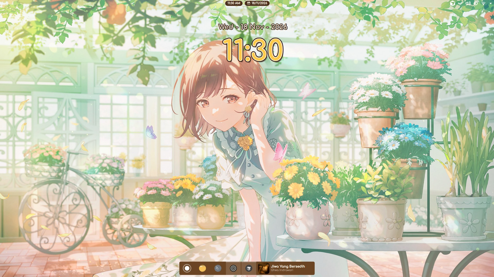
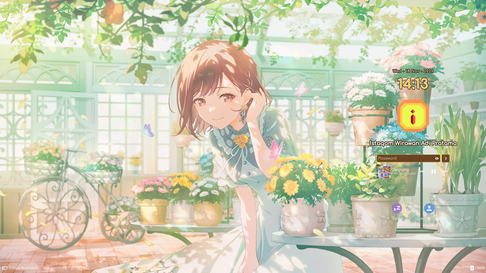
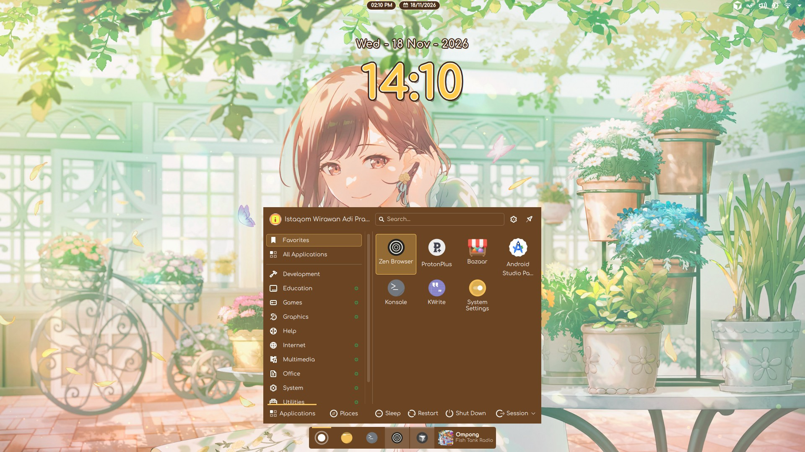

<div align="center">

# Cozy Ena

**Plasma rice for Bazzite** — clear top bar, opaque brown dock & popups,
Vapor colours, Tela-circle-dark, Usagi cursor, Comfortaa, floating gold clock,
and a media dock that grows album art when something is playing.

</div>



| Lock | Login |
|------|-------|
|  |  |



## What's inside

- **Clear top / solid dock.** Wallpaper shows through the top panel; dock and popups stay opaque brown.
- **Clocks.** Big floating gold clock (cream date) on the desktop; a small panel clock in the top bar.
- **Media dock.** Idle: cream ♪. Playing: art + title over MPRIS (YouTube Music, browsers, etc.).
- **Lock screen.** Date above the clock, octagon avatar, password field — same wallpaper as the desk.
- **Splash.** `apply-splash.sh` can bake your local wallpaper into the look-and-feel package.
- **Extras.** Comfortaa, Usagi cursors, a gold Dolphin icon patch inside Tela-circle-dark.

## Wallpaper

The greenhouse desk uses Shinonome Ena's trained card *An Overwhelming Welcome!*
(熱烈歓迎にたじたじ！) from Project SEKAI — © SEGA / Colorful Palette.

Get the art yourself (in-game is the straightforward route). Put a copy under
`~/Pictures/Wallpapers/` if you want splash baking, then pick it in System Settings
for wallpaper and lock.

## Apply

```bash
./cozy-ena/apply.sh
```

Backs up `kdeglobals`, `plasmarc`, and appletsrc under `cozy-ena/backups/` first.

### You still need

- `Tela-circle-dark`
- **Vapor** colour scheme (Bazzite usually ships it)
- That Ena wallpaper (see above)

### What lands where

| Piece | Destination |
|-------|-------------|
| Plasma style `CozyEna` | `~/.local/share/plasma/desktoptheme/CozyEna` |
| Big clock · panel clock · media dock | `~/.local/share/plasma/plasmoids/org.cozyena.*` |
| Splash `Cozy Ena` | `~/.local/share/plasma/look-and-feel/org.cozyena.desktop` |
| Lock screen QML | Plasma shell lockscreen override |
| Comfortaa / Usagi | `~/.local/share/fonts` · `~/.local/share/icons` |

### One script at a time

```bash
./scripts/apply-fonts.sh
./scripts/apply-icons.sh
./scripts/apply-plasma-theme.sh
./scripts/apply-panels.sh
./scripts/apply-mediadock.sh
./scripts/apply-splash.sh
./scripts/apply-lockscreen.sh
./scripts/apply-notify.sh
./scripts/apply-bitwarden-tray.sh
```

### Plasmashell restart

```bash
systemctl --user restart plasma-plasmashell.service
```

Prefer that over bare `plasmashell --replace` — the latter can leave panels dead.

## Notes

- Discord / Cursor tray icons are embedded pixmaps, so the theme cannot recolour them. Keep them visible in the tray; dock icons still use Tela.
- Bitwarden showing twice is SNI + XEmbed. The apply script sets `ELECTRON_OZONE_PLATFORM_HINT=wayland` — restart Bitwarden once.
- Notifications sit top-right (`PopupPosition=TopRight`). No KWin toast-moving hacks.

## Credits

- *An Overwhelming Welcome!* / Shinonome Ena © SEGA / Colorful Palette. Fan rice only.
- Plasma and the rest of the stack belong to their upstreams.
